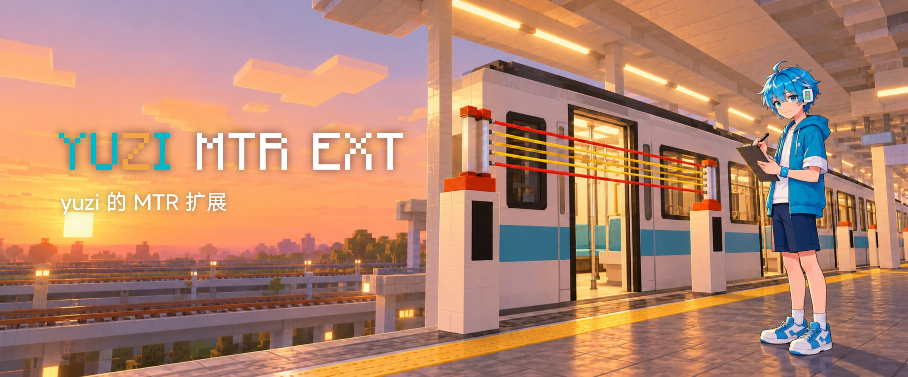

# yuzi 的 MTR 扩展

给 [Minecraft Transit Railway](https://www.minecraftransitrailway.com/)（MTR）4.0.5 打补丁的 Fabric 模组，Minecraft 1.20.1。

我们的服务器从 MTR3 升级到 MTR4 之后，老车包冒出不少显示问题，排图也少了几个 MTR3 时代用惯的功能。这个模组是一路修过来的结果：有的是修 bug，有的是把 MTR3 的用法找回来，还有一些是我们自己想要、就顺手做了的新东西。

## 安装

需要 Minecraft 1.20.1、Fabric Loader、Fabric API 和 MTR 4.0.5（Fabric 版）。

服务端和客户端都要装，版本尽量一致。想在游戏里改设置的话，可以再装一个[模组菜单](https://modrinth.com/mod/modmenu)。

## 修了哪些问题

### 老车包

MTR4 会自动把 MTR3 格式的自定义车包转换过来，但转换后有不少毛病：

- 用 NTE 做的车，部件名前面带着文件名，MTR4 认不出来，整节车厢不显示。
- OBJ 车门开错边；左右镜像的车门，判定位置是反的；车门状态灯一直亮着。
- 车辆模型 60 秒没被看到就会被清掉，再出现时要重新解析整个 OBJ，这期间车门可能再也打不开。现在模型常驻内存，并且按实际编组提前加载，车厢第一次进入视野时也不会卡一下。代价是多占一些内存。
- 贯通道尺寸可以按车型单独调。

换资源包之后请重启客户端，游戏内重载资源包出过把资源包列表清空的问题。

### 渲染和声音

- 开光影之后，屏蔽门和 PIDS 上的字会消失。
- 走行音：断线重连后没声音；同一个声音叠着播放，听起来特别响。修好之后，正常音量会比原来听惯的小一些。

### 坐车

- 车厢里能走到窗边，不会被限制在过道中间那一条。
- 短按 Shift 坐下或站起来，跟 MTR3 一样；长按还是下车。
- 只能从车门上下车：MTR4 本来就只允许从车门下车，但上车不拦，没对准车门往前走会直接穿过车皮掉进轨道。现在车厢侧面有一堵看不见的墙，可以贴着车身走到门口。正在开的车默认不拦，车头和车尾没做。

### 排图和运营

这部分在服务端生效，设置面板需要客户端也装了本模组。

- **按交路设停站时间**：同一个站台，不同交路可以停不同的时间，在站台面板里按交路填。没填的跟站台的停站时间走。改完要刷新一次车厂路径。
- **刷新路径不再清车**：只改了停站时间、限速、信号这类不影响路线形状的东西时，在跑的车会留着（MTR3 就是这样）。轨道本身改了才会清车。
- **改停站时间不用刷新**：保存后，在跑的车马上按新时间停站。PIDS 和时刻表上的预估要等下次刷新才会跟上。
- **时间跳跃不吞班次**：用 `/time set`、睡觉跳过夜晚，或者服务器重启后补时间时，按游戏时间发车的车厂不会再整段丢班次（以前环线上会出现好几个班距的大空档，而且不会自己恢复）。
- **侧线车辆最高速**：侧线面板里可以填一个速度（km/h，0 是不限）。车实际的最高速取它和线路限速里小的那个，晚点追赶也不会超过；PIDS 和时刻表的预估也按这个算。手动驾驶不受影响。保存后会自动刷新车厂，在跑的车马上换成新速度。
- **信号**：
  - 一段轨道刷了两种颜色时，两列车可能在它两头互相等，永远不动。现在列车进区间前会把路上属于这个区间的轨道都查一遍，只要有一段被别的车占着（不管什么颜色），就在区间外面等。如果区间第一段就是站台，车会停在站台外，等前面空了再进站。已经卡死的车要清一次才能恢复。
  - 去掉了「出区间后还要空出一个车长才能进区间」这条规则，和 MTR3、上游新版一样。以前终点站会因为出站方向另一种颜色的区间有车，连站都进不去。代价也和 MTR3 一样：两个方向的车各占交叉进路的一半时还是会卡住，所以道岔区最好和接近它的区间刷成同一种颜色。

刷新路径前先确认线路是通的。施工中寻路失败的话，不管是自动还是手动刷新，都可能把车厂路径清空。不是无限重复的车厂，调低最高速以后单程变长，部分在跑的车会因为班次号失效而消失。在已经有车的轨道上新刷信号前，先把那一段的车清掉，否则 MTR 自己会卡住。

## 新增的东西

### 升降式绳索屏蔽门

创造模式「铁路设施」页里有绳索、带 PIDS 的立柱和纯白立柱，高两格。按「立柱、绳索、立柱」连着摆，整排会跟着车门一起升起和落下，立柱会把开合状态传给另一边的绳索。默认比车门快一倍升起、提前 1.5 秒关、关之前 3 秒响 3 声提示音，这些都能在设置里改。模型、贴图和提示音来自 [RailwayAesthetics-Future](https://github.com/aphrodite281/RailwayAesthetics-Future)。

### 站台广播器

一个按到站、发车时间自动放音频的方块，音频用资源包里的。跟 MTR 自带的广播器比：

- 一个方块可以写好几条规则。每条选站台、交路（可以选隐藏交路，也可以选全部交路）、音频和时间。
- 时间按「到站前后几秒」或「发车前后几秒」算，和站台上的 PIDS、发车倒计时用的是同一套时间。可以选「到点开始放」或者「到点正好放完」，后者会自动读出音频有多长。
- 规则可以复制，粘贴到别的广播器时，站台和交路会自动换成那一站的；对不上的会标成「未生效」。
- 可以只在一个长方体范围里播放。框里的人不管站在哪儿，音量都一样；走出框后半秒内声音淡出，车开走了就听不到上一站的广播。
- 还有一个「续播范围」，默认是整个车站：广播开始的时候人在车站里、又没在坐车，之后走进播放范围，就能从当前进度接着听，已经放完的就不放了。坐车进站的乘客听不到站台上刚放过的那段。淡出需要客户端 1.6.0 以上，续播需要 1.7.0 以上；旧版本客户端照样能听到，只是会一直放完。
- 默认连还没出库的计划班次也会按时间触发，但如果车晚出库 20 秒以上，可能会重复播放。勾上「仅实时班次」就只处理已经出库的车。

### 其他

- 180、250、280、350、380、400、450、500 km/h 八档高速轨道，每档有双向和单向两种。
- MTR 广播器选交路时，能看到远处的和隐藏的交路。
- 交路的「关闭下一站播报」可以设成只关语音，聊天栏的文字照常显示。
- 网页地图的玩家头像地址可以自己定，比如换成 LittleSkin 皮肤站的 `https://littleskin.cn/avatar/player/{name}`。

## 设置

配置文件是 `config/yuzimtr.json`，装了模组菜单的话，大部分开关在游戏里就能改。客户端和服务端各有一份配置，排图、信号、站台广播器这些服务端功能要改服务端那份。

每个功能都有自己的开关。遇到问题可以先把对应的开关关掉，看看是不是它引起的；一些功能还有调试日志开关（`debug` 开头的那些）。

车包相关的两项只能在 JSON 里写：`consistSizes`（每种车的编组长度，用来提前加载模型）和 `gangwayOverrides`（贯通道尺寸）。不写也能用，只是有些车厢第一次出现时可能会卡一下。写了 `consistSizes` 的车会自动预加载，MTR 自己 `config/mtr.json` 里的 `preloadResourcePattern` 可以留空。

## 自己构建

```bash
./gradlew build
```

不用自己装 JDK 17，Gradle 会自动下载。构建出来的 jar 在 `build/libs/`。

`./gradlew runGametest` 会起一个测试服务器跑自动化测试，结果在 `build/gametest-results.xml`。想构建后直接把 jar 拷进 mods 目录的话，在 `~/.gradle/gradle.properties` 里写上 `client_mods_dir` 和 `server_mods_dir`，然后用 `./gradlew deployToClient` 或 `./gradlew deployToServer`。

每个改动具体是怎么实现的、MTR 那边为什么会出问题，写在 [AGENTS.md](AGENTS.md) 和 `docs/agent-notes/` 里。

## 许可

AGPL-3.0。绳索屏蔽门的模型、贴图和音效来自 RailwayAesthetics-Future（AGPL-3.0），高速轨道的物品贴图改自 MTR（MIT），详见 [CREDITS.txt](src/main/resources/CREDITS.txt)。
